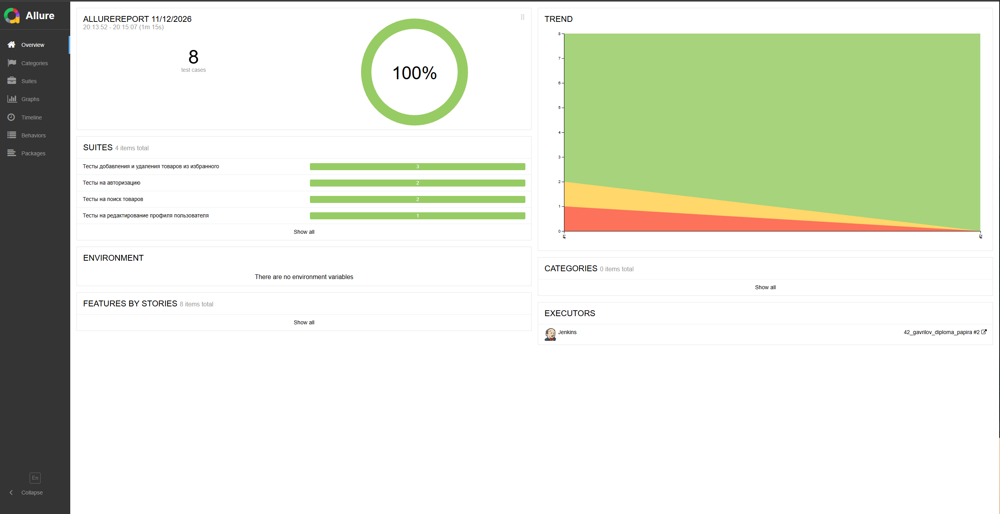
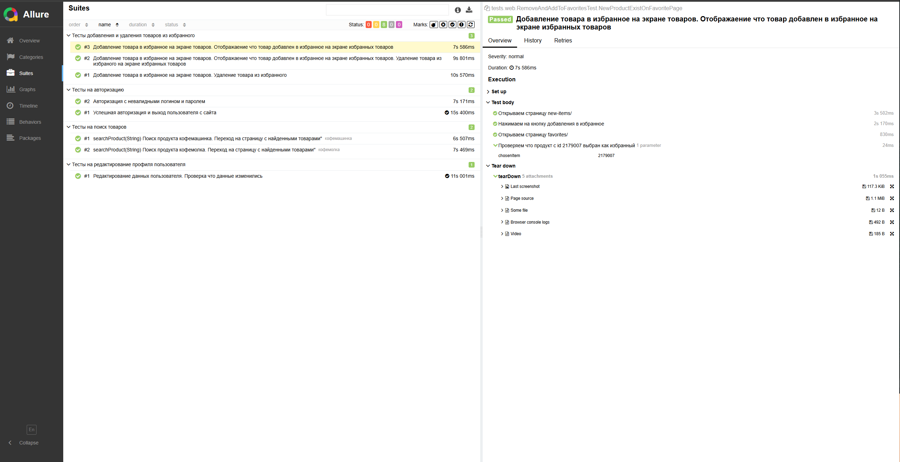

# UI-тесты сайта Kitfort

Автоматизированные UI-тесты интернет-магазина [Kitfort](https://kitfort.ru/).

Проект проверяет основные пользовательские сценарии сайта: авторизацию, редактирование профиля, работу со списком избранного и поиск товаров по параметризованным тестовым данным.

## Содержание

- [Технологии](#технологии)
- [Структура проекта](#структура-проекта)
- [Покрытие тестами](#покрытие-тестами)
- [Настройка](#настройка)
- [Запуск тестов](#запуск-тестов)
- [Запуск в удалённом браузере](#запуск-в-удалённом-браузере)
- [Allure-отчёт](#allure-отчёт)
- [Архитектура](#архитектура)

## Технологии

| Технология | Назначение |
|---|---|
| Java | Язык разработки |
| Gradle | Сборка и запуск тестов |
| JUnit Jupiter 5.14.3 | Тестовый фреймворк |
| Selenide 7.18.2 | Управление браузером и UI-проверки |
| Allure 2.32.0 | Отчётность и шаги тестов |
| Allure Gradle Plugin 2.12.0 | Интеграция Allure с Gradle |
| Owner 1.0.4 | Чтение конфигурации |
| DataFaker 2.5.4 | Генерация тестовых данных |
| AssertJ 3.27.7 | Библиотека проверок |
| SLF4J Simple 2.0.17 | Логирование |
| Commons IO 2.11.0 | Работа с файлами и потоками |

## Структура проекта

```text
diploma_papira_kitfort/
├── build.gradle
└── src/
    └── test/
        ├── java/
        │   ├── config/
        │   │   ├── ConfigProvider.java
        │   │   ├── TestDataConfig.java
        │   │   └── WebUIConfig.java
        │   ├── helpers/
        │   │   └── Attach.java
        │   ├── pages/
        │   │   ├── FavoriteProductsPage.java
        │   │   ├── MainPage.java
        │   │   ├── NewProductsPage.java
        │   │   ├── PersonalAccountPage.java
        │   │   ├── ProductsPage.java
        │   │   └── components/
        │   │       ├── FavoriteIconComponent.java
        │   │       └── LoginFormComponent.java
        │   ├── testdata/
        │   │   └── TestData.java
        │   └── tests/
        │       └── web/
        │           ├── AuthorizationTests.java
        │           ├── BaseTest.java
        │           ├── EditProfileTest.java
        │           ├── RemoveAndAddToFavoritesTest.java
        │           └── SearchProductTest.java
        └── resources/
            ├── configurations/
            │   └── web/
            │       ├── TestData.properties
            │       └── WebUIConfig.properties
            └── query.csv
```
## Архитектура

Проект использует паттерн **Page Object**:

- `pages/` — объекты страниц сайта и действия на них;
- `pages/components/` — переиспользуемые компоненты интерфейса: форма входа и иконка избранного;
- `tests/web/` — тестовые сценарии;
- `config/` — интерфейсы конфигурации и единая точка доступа к настройкам;
- `testdata/` — генерация и хранение тестовых данных;
- `helpers/Attach.java` — подготовка вложений для Allure.

`BaseTest` выполняет общую настройку Selenide перед тестами и закрывает WebDriver после каждого теста. В нём также централизована конфигурация локального/удалённого браузера и Selenoid capabilities.

## Покрытие тестами

В проекте реализовано 5 тестовых классов и 8 запусков тестовых сценариев с учётом строк параметризованного поиска.

### Авторизация — `AuthorizationTests`

1. Успешная авторизация пользователя, проверка email в личном кабинете и выход из аккаунта.
2. Попытка авторизации с невалидными логином и паролем, проверка сообщения об ошибке.

### Редактирование профиля — `EditProfileTest`

1. Авторизация пользователя.
2. Изменение имени, фамилии, отчества и даты рождения.
3. Сохранение изменений и проверка уведомления.
4. Повторное открытие профиля и проверка сохранённых значений.

Данные профиля генерируются библиотекой DataFaker.

### Избранное — `RemoveAndAddToFavoritesTest`

1. Добавление товара в избранное со страницы новинок и проверка состояния.
2. Удаление товара из избранного и проверка, что он больше не отмечен.
3. Добавление товара и проверка его отображения на странице избранного.
4. Удаление товара непосредственно со страницы избранного и проверка пустого списка.

### Поиск товаров — `SearchProductTest`

Тест параметризован через `@CsvFileSource` и читает запросы из `src/test/resources/query.csv`.

Текущие тестовые запросы:

- `кофемашинка`
- `кофемолка`

Для каждого запроса тест выполняет поиск, проверяет URL страницы результатов и убеждается, что список товаров не пуст.

Чтобы добавить новый поисковый сценарий, внесите отдельный запрос в `query.csv` — по одному значению на строку.

## Настройка

### Конфигурация браузера

Файл `src/test/resources/configurations/web/WebUIConfig.properties`:

```properties
browser=chrome
browserVersion=156
browserSize=1920x1080
headless=false
holdBrowserOpen=false
baseUrl=https://kitfort.ru/
```

Конфигурация также поддерживает переопределение значений через системные свойства Java/Gradle. Например:

```bash
gradle clean test -Dbrowser=chrome -Dheadless=true
```

В `BaseTest` значение удалённого адреса WebDriver читается из системного свойства `remoteURL`.

### Учётные данные

Файл `src/test/resources/configurations/web/TestData.properties` содержит параметры:

```properties
user.validEmail=
user.validPassword=
```

Заполните их действующими тестовыми учётными данными, чтобы запускать сценарии успешной авторизации и редактирования профиля. Не добавляйте реальные пароли в публичный репозиторий. Для CI предпочтительно передавать значения через защищённые переменные окружения/системные свойства.

Ключи также доступны как системные свойства Owner:

```bash
gradle clean test -Duser.validEmail="your-email" -Duser.validPassword="your-password"
```

В тестах негативной авторизации используются отдельные заведомо некорректные значения, заданные в `TestData`.

## Запуск тестов

Запуск всего набора:

```bash
gradle clean test
```

Запуск отдельного тестового класса:

```bash
gradle test --tests "tests.web.AuthorizationTests"
gradle test --tests "tests.web.EditProfileTest"
gradle test --tests "tests.web.RemoveAndAddToFavoritesTest"
gradle test --tests "tests.web.SearchProductTest"
```

Запуск с переопределением настроек браузера:

```bash
gradle clean test -Dbrowser=chrome -DbrowserVersion=156 -DbrowserSize=1920x1080 -Dheadless=true
```

## Запуск в удалённом браузере

`BaseTest` настраивает capabilities для Selenoid: включены VNC и запись видео. Для подключения укажите URL удалённого WebDriver через `remoteURL`:

```bash
gradle clean test -DremoteURL="http://selenoid-host:4444/wd/hub"
```

Замените адрес на URL своего Selenoid/WebDriver. При локальном запуске `remoteURL` можно не указывать.

После каждого теста в Allure прикладываются:

- скриншот браузера;
- HTML-код страницы (page source);
- текстовое вложение;
- логи консоли браузера;
- ссылка на видеозапись Selenoid.

## Allure-отчёт

Результаты Allure формируются в `build/allure-results`.

Сгенерировать отчёт:

```bash
gradle allureReport
```

Открыть отчёт локально:

```bash
gradle allureServe
```





## Allure TestOps
Интеграция с Allure TestOps прдоставляет возможность сохранять результаты прогонов и отслеживать историю запускок


